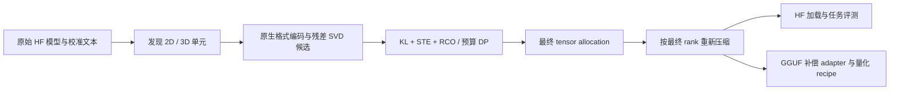

# BR-MoE：RCO 的引入、Per-3D-Tensor 分配与精度/性能结果

记录日期：2026-11-11。本文依据当前源码、`run_55343` 的最终分配及保留的评测产物整理。算法能力、实际配置和已完成的实测分别说明；旧设计稿中的性能设想不作为实测结论。

本次同步的轻量实验记录见 [GitHub 可查的结果快照](perf/rco_qwen15_20261111/README.md)。文中其余 `artifacts/runs/` 路径为本地运行产物，模型和逐题数据不随仓库上传。

目前可以确认：BR-MoE 已把“量化格式与低秩补偿 rank 联合分配”接入端到端 KL 驱动的 RCO 搜索，默认按 routed expert 的 3D 投影张量、attention/shared expert 的 2D 投影矩阵分配。Qwen1.5-MoE 的一轮完整搜索得到 **4.757225 GiB 的所选权重及补偿载荷**，最终压缩模型在 **PIQA validation 全部 1,838 题上的准确率为 79.3254%**。这轮解的 **72 个 routed 3D 单元全部为 rank 0**，补偿仅分配给 attention/shared expert，因而还不能用它证明 routed 3D 补偿本身的精度收益。

## 1. 为什么在 BR-MoE 中引入 RCO

### 1.1 保留 Bit–Rank 耦合，改变分配目标的获得方式

BR-MoE 的基本近似是：

\[
W\approx\widehat W_q+UV,\qquad
U\in\mathbb R^{D_{\mathrm{out}}\times r},\quad
V\in\mathbb R^{r\times D_{\mathrm{in}}}.
\]

提高量化位宽会增加基础权重成本；增大 rank 会增加补偿成本。两者共同决定重建误差，同一预算既可以用于更高精度基底，也可以用于低精度基底与补偿。因此分配动作应是联合的 `(quant_type, rank)`，而不是先定 bit，再独立补 rank。

原 ILP 路径采集逐专家、逐配置的局部误差，再求解：

\[
\min_x\sum_i\sum_k f_iL_{i,k}x_{i,k},\quad
\sum_kx_{i,k}=1,\quad
\sum_{i,k}c_{i,k}x_{i,k}\le B,\qquad
x_{i,k}\in\{0,1\}.
\]

这里的 `f_i L_{i,k}` 是预先填好的局部代理损失。它便于优化，但不能完整表达“多个层同时压缩后，误差沿网络传播、交互，并改变后续路由与 logits”的影响。ILP 对代理问题的求解质量，与代理是否准确预测整网质量，是两件事。

引入 RCO 后，保留离散 Bit–Rank 候选及预算约束，同时增加一条直接使用真实模型前向的路径：**通过原模型与整网压缩候选模型的下一词分布 KL，更新各单元对候选配置的偏好。**

RCO 指 **Riemannian Constrained Optimization**，来自 Michael Helcig 与 Dan Alistarh 的 [Model Compression with Exact Budget Constraints via Riemannian Manifolds](https://arxiv.org/abs/2605.00649)。仓库将预算流形、Gumbel STE 与预算内离散选择用于 BR-MoE 的联合格式/rank 分配。

### 1.2 当前路径的区别

| 路径 | 损失来源 | 能否通过目标反映整网交互 | 用途 |
| --- | --- | --- | --- |
| 原 ILP / `proxy` | 预采集专家误差表，可结合频率 | 不能直接反映 | 快速求代理目标下的分配 |
| `tensor_proxy` | 实际权重的重建残差平方，可按输入通道重要性加权 | 不能直接反映 | 真实张量、真实 codec 下的较便宜搜索 |
| `e2e_kl` | 原模型与当前整网压缩候选的输出 KL | 可以 | 预算内优化实际模型输出分布 |

RCO 的意义是拓展可优化目标并维护连续期望预算。目前没有匹配实验能证明它在所有场景中优于 ILP。

源码：[ILP_solver/solver.py](../ILP_solver/solver.py)、[full_model_search.py](../RCO_solver/full_model_search.py)、[e2e_ste.py](../RCO_solver/e2e_ste.py)。

## 2. Per-3D-Tensor 分配的核心 idea

### 2.1 将决策粒度对齐到专家投影张量

设每层有 `E` 个 routed experts，隐藏维度为 `H`，专家中间维度为 `I`。同类投影可表示为：

\[
W_{l,\mathrm{gate}},W_{l,\mathrm{up}}\in\mathbb R^{E\times I\times H},
\qquad W_{l,\mathrm{down}}\in\mathbb R^{E\times H\times I}.
\]

默认 `--granularity tensor` 为这三个 3D 张量分别选配置：

```text
第 l 层：
  L{l}_gate_exps -> 一种 quant_type、一个 rank，覆盖 E 个 gate 投影
  L{l}_up_exps   -> 一种 quant_type、一个 rank，覆盖 E 个 up 投影
  L{l}_down_exps -> 一种 quant_type、一个 rank，覆盖 E 个 down 投影
```

同组专家共享格式和 rank，**每个专家的权重、量化参数及补偿因子仍独立**。例如选择 `(IQ3_S,16)` 时：

\[
W_{t,e}\approx\widehat W_{t,e}^{\mathrm{IQ3\_S}}+
U_{t,e}^{(16)}V_{t,e}^{(16)}.
\]

各专家因子可堆叠成规整三维张量：

\[
U_t\in\mathbb R^{E\times D_{\mathrm{out}}\times r_t},
\qquad V_t\in\mathbb R^{E\times r_t\times D_{\mathrm{in}}}.
\]

统一的是配置和形状，不是让专家共用一组 U/V。当前 HF 搜索仍可用多个 2D Linear 保存专家，只让它们引用同一个分配变量；逻辑上的 3D 决策不要求搜索时先把权重物理拼成连续张量。

### 2.2 工程动机与代价

逐专家异构 bit/rank 提供更多自由度，但融合 MoE 算子可能需要按格式拆桶、处理变长 rank、填充及额外分派。Per-3D-Tensor 将同一投影组变为统一类型、统一 rank，更容易映射到 GGUF 专家张量及批量专家计算。

代价是放弃同组专家之间的格式/rank 自由度。这是**分配自由度与运行规整性之间的取舍**；实际吞吐收益与精度代价需要在同模型、预算和后端上测量。

gate/up/down 保持独立，是因为三者敏感度可以不同，不必整层同配。当前 Qwen 解中 down 全部为 IQ4_NL，gate/up 多为 IQ2 系列，体现了投影级差异。

### 2.3 各种粒度的绑定关系

下表只统计 routed 部分，attention/shared 的 2D 单元另计。

| `granularity` | routed 决策数 | 共享关系 |
| --- | ---: | --- |
| `layer` | `L` | 一层所有专家及三个投影共用配置 |
| `vllm_tensor` | `2L` | gate/up 绑定为 w13，down 为 w2 |
| `tensor` | `3L` | 每层 gate、up、down 分别决策 |
| `expert` | `LE` | 每专家独立，但该专家三个投影绑定 |
| `expert_tensor` | `3LE` | 每专家、每投影独立 |

`tensor` 与 `expert` 约束维度不同，可行域互不包含。比较粒度自由度时，应用 `expert_tensor` 作更细的对照，不能仅按变量数量判断精度上界。

Qwen1.5-MoE 的 `L=24,E=60`：routed 从 `expert_tensor` 的 4,320 个决策变为 `tensor` 的 72 个；加上 96 个 attention 和 72 个 shared 单元，当前实际总数为 **240 个决策**。

源码：[tensor_units.py](../RCO_solver/tensor_units.py) 第 16–47 行；[e2e_ste.py](../RCO_solver/e2e_ste.py) 的 `_map_projection_to_unit_key`。

## 3. 候选、成本与校准统计

### 3.1 用具体量化类型代替抽象 bit

IQ4_XS 与 IQ4_NL 都属于名义 4-bit，但编码和成本不同，应为不同候选。named-format 路径使用固定版本 GGML 原生 encoder，搜索与压缩使用同一格式定义。

| 格式 | 元素/块 | 字节/块 | 实际 bits/weight |
| --- | ---: | ---: | ---: |
| IQ2_XXS | 256 | 66 | 2.0625 |
| IQ2_XS | 256 | 74 | 2.3125 |
| IQ2_S | 256 | 82 | 2.5625 |
| Q2_K | 256 | 84 | 2.6250 |
| IQ3_XXS | 256 | 98 | 3.0625 |
| Q3_K / IQ3_S | 256 | 110 | 3.4375 |
| IQ4_XS | 256 | 136 | 4.2500 |
| Q4_K / IQ4_NL | 256 / 32 | 144 / 18 | 4.5000 |

成本包含块内元数据，不能直接用名字里的 2、3、4 作为实际存储位宽。

### 3.2 精确到 payload 字节的预算

对于由多个专家矩阵组成的单元 `t`，选择格式 `q`、rank `r`：

\[
c_{t,(q,r)}=\sum_{e\in t}
\left[\frac{D_{\mathrm{out},e}D_{\mathrm{in},e}}{s_q}b_q
+2r_e(D_{\mathrm{out},e}+D_{\mathrm{in},e})\right].
\]

`s_q` 为每块元素数，`b_q` 为每块字节数；第二项按当前 FP16 U/V 的每元素 2 字节计，`r_e=min(r,D_out,e,D_in,e)`。2D 单元只包含一个矩阵。

行宽不满足块对齐要求的候选被 mask，不做隐式 padding 或格式替换。`F16_rank0` 为无法块对齐的矩阵保留候选。`--avg_bits a` 转换为：

\[
B_{\mathrm{MiB}}=\frac{N_{\mathrm{selected}}a}{8\times2^{20}}.
\]

**预算只包含所选基础权重和补偿 payload**。固定参数、bias、文件容器开销、激活、KV cache、临时反量化缓冲均不在其中。因此 3.0 平均位宽不等于整个模型均为 3-bit，也不等于推理显存就是该 payload 大小。

### 3.3 Rank 提供额外预算调节方向，但开销依赖形状

以当前 Qwen routed 投影 `E=60,D_out=1408,D_in=2048` 为例：

| rank | 整个 3D 单元新增 FP16 U/V | 相对原权重元素的附加 bpw |
| --- | ---: | ---: |
| 16 | 6.328125 MiB | 0.3068 |
| 32 | 12.656250 MiB | 0.6136 |
| 64 | 25.312500 MiB | 1.2273 |
| 128 | 50.625000 MiB | 2.4545 |

该张量增加 1 bpw 的成本为 20.625 MiB。小 rank 能填补部分格式档位间隙，较大 rank 也可能比升级格式更贵。不能笼统声称“rank16 仅多约 5%”或“补偿计算始终不足主矩阵的 3%”。

### 3.4 输入重要性与专家频率

full-tensor 路径采集每个 Linear 输入通道的均方激活。需要 imatrix 的 IQ2_XXS/IQ2_XS 使用这些统计；若某专家未被校准数据路由到、缺少必需统计，会对整个 3D 单元屏蔽相关格式，不伪造均匀统计。

`tensor_proxy` 使用重建残差平方，并在有统计时按输入通道重要性加权。`e2e_kl` 的目标是整网 KL，没有再显式乘一遍专家频率；专家重要性通过真实路由、激活和反向梯度进入优化。

这不等于“对每个专家训练频率加权 SVD”。当前 U/V 来自各自权重量化残差的随机低秩分解。

源码：[formats.py](../brmoe_quant/formats.py)、[tensor_units.py](../RCO_solver/tensor_units.py) 第 50–108 行、[full_model_search.py](../RCO_solver/full_model_search.py)。

## 4. RCO 如何执行联合分配

### 4.1 连续分配变量和预算流形

每个单元 `t` 有 `K` 个候选，维护 logits `alpha[t,k]`：

\[
p_{t,k}=\operatorname{softmax}(\alpha_t)_k,\qquad
C(\alpha)=\sum_{t,k}p_{t,k}c_{t,k}=B.
\]

不同张量形状不同，成本必须为 `N×K` 矩阵。第 3.2 节的成本公式以字节表示，进入优化前除以 `2^20`，统一为 MiB。不可用候选被屏蔽。新的 `e2e_kl` full-tensor CLI 路径从可用候选的零 logits 开始，再初始化到预算面；不使用旧专家误差表给 attention/shared 构造先验。`tensor_proxy` 则默认用模型派生代理损失进行 warm start。

闭式法向量：

\[
n_{t,k}=p_{t,k}\left(c_{t,k}-\sum_jp_{t,j}c_{t,j}\right).
\]

对 KL 梯度 `g` 做切空间投影：

\[
g_T=g-\frac{\langle g,n\rangle}{\|n\|^2}n.
\]

执行 Adam 后沿成本方向回缩：

\[
\alpha'\leftarrow\alpha_{\mathrm{Adam}}+s c,\qquad C(\alpha')=B.
\]

沿该方向的成本导数为各行成本方差之和，因而可二分求 `s`。最后将 Adam 一阶动量投影到新切空间。Adam 逐元素预条件后的方向未必仍严格切向，预算由后续回缩恢复。

### 4.2 一步搜索发生什么

```text
准备：冻结原模型；缓存校准输入的教师 logits；发现决策单元和可用候选

每一步：
  1. 加 Gumbel 噪声，得到 (alpha + noise) / temperature
  2. 预算 DP 选择一套离散候选，前向只执行这套选择
  3. 在一条校准序列上执行整网压缩候选模型
  4. 计算 KL(P_original || P_compressed)，Streaming STE 反传到 alpha
  5. 梯度投影 -> Adam -> 预算回缩 -> 一阶动量运输

结束：对无噪声 log_softmax(alpha) 再做预算 DP，得到最终 best 配置
```

KL 在有效 token 上求平均：

\[
\mathcal L=\frac1{|\mathcal V|}\sum_{u\in\mathcal V}\sum_v
P_{\mathrm{orig}}(v\mid x_{\le u})
\log\frac{P_{\mathrm{orig}}(v\mid x_{\le u})}
{P_q(v\mid x_{\le u})}.
\]

模型权重及补偿因子在搜索中冻结，**只优化分配 logits alpha**。当前每步使用一条校准序列，按 `step % num_samples` 循环；每步只抽一份 Gumbel 噪声。

温度从 1.0 退火到 0.05。注意：`(alpha+gumbel)/tau` 对整张 DP 分数表做共同正缩放，理论上不改变当步 hard allocation；温度直接改变 soft probabilities 与 STE 梯度。它不会单独缩小噪声相对 alpha 的幅度。最终确定化来自最后一次**去掉噪声**的 DP。

### 4.3 Streaming STE 与最大 rank 前缀复用

每个矩阵、每种具体格式先编码一次，对残差 `W-Wq` 做一次最大 rank 的 `torch.svd_lowrank`。较小 rank 取因子前缀：

\[
W^{(q,r)}=\widehat W_q+U_{:,:r}V_{:r,:}.
\]

前向只算所选候选，反向通过 STE 给其他候选偏好提供梯度。示意为：

\[
\frac{\partial\mathcal L}{\partial p_{t,(q,r)}}=
\sum_e\langle G_{t,e},\widehat W_{t,e,q}\rangle+
\sum_e\sum_{j=1}^{r}
\langle G_{t,e},U_{t,e,:,j}V_{t,e,j,:}\rangle.
\]

各 rank 的低秩项可前缀累加复用。实现根据 token/矩阵规模在激活空间或权重梯度空间计算，减少重复量化、SVD 和完整 dense 候选存储。

这里是随机近似 SVD，不是严格最优分解。搜索取最大 rank 前缀，最终压缩按所选 rank 重新拟合，补偿数值可能不同，必须评测**最终压缩 checkpoint**。

### 4.4 连续预算、离散预算与最优性

需要分开检查：

- 连续变量：`C(alpha)=B`，回缩误差可达到约 `1e-8 MiB`。
- 最终模型：每行选一个候选，真实 payload 总成本 `<=B`，可以有余量。

当前 DP 将成本网格化，再以真实成本检查和修复超预算，并尝试利用剩余预算。它优化当前分数表，不是直接枚举所有模型的 KL。STE、有限校准/迭代与成本离散化意味着：**最终配置没有真实 KL 全局最优保证**。

“更大 bit/rank 在每个样本上必定降低 KL”也没有保证。预算等式是建模选择，不能由权重重建误差直接推导整网 KL 的严格单调性。

源码：[manifold.py](../RCO_solver/manifold.py) 的 `BudgetManifold.step`、`dp_solve_mckp`；[e2e_ste.py](../RCO_solver/e2e_ste.py) 第 710–858 行及 `_FactorizedPrefixSTELinearFn`。

## 5. 当前实现与框架适配边界



| 能力 | 当前状态 |
| --- | --- |
| routed 3D 与 attention/shared 2D 联合搜索 | 已实现，有真实整网搜索产物 |
| 原生块字节成本与 FP16 补偿计费 | 已实现 |
| 部分 IQ/K 的 GPU decode、packed cache、因子复用 | 已实现，有一致性及阶段性能记录 |
| 配置压缩保存、HF 重载与 PIQA | 已有完整结果 |
| 2D/3D 补偿 GGUF adapter、格式 recipe 导出 | 已实现导出能力 |
| 完整 HF→GGUF 基模型转换、与 HF 字节一致的双 GGUF | 当前导出器尚未独立提供完整闭环 |
| 最新混合 IQ+rank 的 llama.cpp 正式端到端性能 | 未找到完成的测量产物 |
| 最新混合 IQ+rank 在自定义 INT3 vLLM 后端执行 | 需要对应格式算子和适配，不能由 IQ 搜索支持推定 |

规整 3D 张量为 indexed matmul/LoRA adapter 提供基础。gate/up 补偿应在激活前加回，down 补偿在相应线性投影处加回，且只需计算被路由专家切片。

当前 GPU decode 将 packed 数据解为临时 dense 矩阵，再执行矩阵乘，**没有新增 IQ fused inference GEMM**。既有 INT3 vLLM 性能不能外推到 IQ。GGUF recipe 经外部重新量化时，也可能因重要性统计和残差处理不同而与保存模型不一致。

依据：[full_tensor_iq.md](full_tensor_iq.md) 第 115–156 行、[rco_gpu_decode_20261022.md](rco_gpu_decode_20261022.md)、[export_brmoe_to_gguf.py](../tools/export_brmoe_to_gguf.py)。

## 6. 最新完整搜索：Qwen1.5-MoE，run_55343

### 6.1 实验配置

| 项目 | 内容 |
| --- | --- |
| 模型 | Qwen1.5-MoE-A2.7B，24 层、每层 60 routed experts |
| 决策 | 240：attention 96、routed 72、shared 72 |
| 关联的实际 Linear 模块 | 4,488 |
| 粒度 / 目标 | `tensor` / `e2e_kl` |
| 候选格式 | Q2_K、Q3_K、Q4_K、IQ2_XXS、IQ2_XS、IQ2_S、IQ3_XXS、IQ3_S、IQ4_XS、IQ4_NL、F16 |
| rank | 0、16、32、64、128；F16 仅 rank0，共 51 候选 |
| 校准 | 128 条，每条最多 256 token；seed 42 |
| 优化 | 300 步，学习率 0.1，温度 1.0→0.05 |
| 所选元素数 | 13,690,208,256 |
| 预算 | 平均 3.0 bpw，即 4,896 MiB selected payload |
| 计算 / 补偿精度 | FP16 / FP16 |
| 搜索资源配置 | 单 H200、8 CPU 线程、48 GiB packed cache，原权重与最大 rank 因子驻留 GPU |
| 固定范围 | embedding、lm_head、router、LayerNorm 等未搜索参数保持原精度 |

依据：[rco_full_e2e.slurm](../bench/slurm/rco_full_e2e.slurm)、[best_tensor_allocation.json](perf/rco_qwen15_20261111/rco_e2e/run_55343/best_tensor_allocation.json)、[progress.jsonl](perf/rco_qwen15_20261111/rco_e2e/run_55343/progress.jsonl)。

### 6.2 最终载荷与实际分配

| 类别 | 决策数 | rank>0 数 | payload MiB | payload GiB |
| --- | ---: | ---: | ---: | ---: |
| Attention | 96 | 49 | 176.343750 | 0.172211 |
| Routed experts | 72 | **0** | 4,372.500000 | 4.270020 |
| Shared experts | 72 | 31 | 322.554688 | 0.314995 |
| 合计 | 240 | 80 | **4,871.398438** | **4.757225** |

精确载荷为 **5,108,031,488 字节**，平均 **2.984926 bpw**；预算利用率 **99.4975%**，余量 **24.601563 MiB**。U/V 共 **25.546875 MiB**，占 selected payload 的 **0.5244%**；这是这个配置的补偿存储比例，不能当作任意配置的开销。

| rank | 0 | 16 | 32 | 64 | 128 |
| --- | ---: | ---: | ---: | ---: | ---: |
| 全部 | 160 | 37 | 31 | 11 | 1 |
| Attention | 47 | 22 | 20 | 7 | 0 |
| Routed | 72 | 0 | 0 | 0 | 0 |
| Shared | 41 | 15 | 11 | 4 | 1 |

24 个 routed down 全为 **IQ4_NL/r0**；48 个 gate/up 中，37 个 IQ2_XXS、3 个 IQ2_XS、4 个 IQ2_S、4 个 Q2_K，全部 rank0。

在本轮候选、校准、预算和轨迹下，优化器把 routed 预算更多用于 down 基底精度，把补偿分配给部分 2D attention/shared 投影。这不证明其为唯一/全局最优配置，也不证明 routed 补偿没有价值。

逐层配置见 [compression_config.md](perf/rco_qwen15_20261111/rco_e2e/run_55343/compression_config.md) 与 [compression_config.csv](perf/rco_qwen15_20261111/rco_e2e/run_55343/compression_config.csv)。

### 6.3 KL 日志的含义

首步 KL 为 0.247324，末步 0.199999；前 20 步平均约 0.262227，后 20 步平均约 0.123263。每步文本和采样配置不同，这只是优化轨迹，不能当作固定验证集前后对照；末步也不是最终无噪声配置的全校准集 KL。

最终连续预算误差约 **7.51e-9 MiB**，300 步最大记录误差小于 `1e-8 MiB`。这验证连续回缩精度，实际离散模型仍有 24.60 MiB 余量。

## 7. 精度结果

### 7.1 PIQA：最终 checkpoint 的完整评测

| 项目 | 结果 |
| --- | --- |
| 作业 / 状态 | 56019 / `complete` |
| Checkpoint | `artifacts/runs/rco_e2e/run_55343/compressed` |
| 数据集 | PIQA validation，0-shot |
| 完成题数 | 1,838 / 1,838 |
| `acc` | **79.3254%**，1,458 / 1,838 |
| `acc_norm` | **79.3254%**，1,458 / 1,838 |
| 归一化 | candidate character count |
| Prompt | `Question: {goal}\nAnswer:`，候选前加空格，不加 special tokens |
| GPU / batch | RTX 4090 / 2 |
| 评测段耗时 | 881.604 s |
| 总 elapsed | 1,000.068 s |
| PyTorch GPU peak | 6.432185 GiB |

评测计算候选 continuation 的 token log-likelihood，而非自由生成答案；`acc_norm` 再按候选字符数归一化。结果保存了 allocation、importance 和评测配置 SHA256。allocation 指纹 `ac8f279c97288a063fb89c224ca48b017e1ed7d9a00514adab6bf1396cce1c39` 与最终压缩清单一致。

独立重算全部预测记录，两项指标均为 1,458 题正确；两种指标有 290 条预测不同，只是最终得分相同。`reference_max_logit_difference=0.0` 验证同一压缩模型的重载/参考路径一致性，不是说它与 FP16 教师 logits 相同。

证据：[results.json](perf/rco_qwen15_20261111/piqa/run_56019/results.json)、`artifacts/runs/piqa/run_56019/predictions.jsonl`、[COMPRESSION_COMPLETE.json](perf/rco_qwen15_20261111/rco_e2e/run_55343/compressed/COMPRESSION_COMPLETE.json)、[eval_compressed_piqa.py](../bench/eval_compressed_piqa.py)。

### 7.2 精度结论的边界

未找到同模型、prompt、数据、预算和评测实现的 FP16、uniform quant、ILP 或无补偿基线。目前只能报告绝对 PIQA 分数，不能量化“RCO 提升多少”“Per-3D-Tensor 比逐专家好多少”或“补偿恢复多少损失”。

尤其 routed 全部 rank0，这轮不是 routed 3D 补偿有效性的消融证据。attention/shared 的非零 rank 是否改善质量，也需要去掉补偿的匹配对照。

### 7.3 新评测套件尚未形成最终结果

本次 GitHub 同步时，四项新增任务已重提到以下作业，状态汇总已记录进行中的进度，尚无完整最终指标；PIQA 继续复用 56019 的完整结果。

| 任务 | 当前 Job | 快照状态 |
| --- | --- | --- |
| MMLU | 61656 | 进行中，暂无完整最终指标 |
| HellaSwag | 61657 | 进行中，暂无完整最终指标 |
| WikiText-2 / LAMBADA OpenAI | 61658 | 前者进行中；后者等待或加载，暂无最终指标 |

不能给出这套新配置的 PPL、其他任务最终分数或完整平均分。进度是同步时的静态快照，不代表当前实时调度状态。

证据：[作业记录](perf/rco_qwen15_20261111/eval_suite_20261111/jobs.json)、[五项评测状态快照](perf/rco_qwen15_20261111/eval_suite_20261111/summary.md)。

### 7.4 原 BR-MoE 历史精度，仅作背景

以下为 README 既有表格，不是新 RCO/per-3D-Tensor 配置的复测：

| 模型 | 方法 | 原表 Memory | WikiText-2 PPL↓ | Average Score↑ |
| --- | --- | ---: | ---: | ---: |
| Mixtral-8×7B | FP16 | 88.90 GB | 3.700 | 80.48 |
| Mixtral-8×7B | GPTQ-3bit | 18.43 GB | 4.730 | 73.80 |
| Mixtral-8×7B | BR-MoE | 20.36 GB | 4.095 | 77.83 |
| DeepSeek-MoE | FP16 | 31.24 GB | 5.832 | 68.82 |
| DeepSeek-MoE | GPTQ-3bit | 6.97 GB | 6.843 | 62.14 |
| DeepSeek-MoE | BR-MoE | 8.18 GB | 6.180 | 67.70 |

保留原表 Memory/GB 口径，不把它与 selected payload/GiB 视为同一指标。README 引用外部 RCO 论文的 Qwen PPL 也不属于 `run_55343` 实测。

来源：[README.md](../README.md) 的 Results Highlights。

## 8. 性能结果：搜索、当前模型运行及历史 INT3 推理

### 8.1 最新全模型搜索的耗时和资源

由 `run_55343/progress.jsonl` 重算：

| 指标 | 记录值 |
| --- | ---: |
| 校准完成时累计 wall time | 457.284 s |
| 128 条参考前向阶段 | 47.854 s |
| 第 0 步，含首次候选初始化 | 4,781.107 s，约 79.69 min |
| 全 300 步单步中位数 | 9.2444 s |
| 最后 100 步单步中位数 | 9.1997 s |
| 至最后一次优化步的累计 wall time | **8,090.764 s，约 2.247 h** |
| 日志采样最大 CUDA allocated | 93.0978 GiB |
| 日志采样最大 CUDA reserved | 96.7559 GiB |
| 日志中的 host peak RSS | 55.6895 GiB |

2.247 h 截止最后一个优化步，不含后续最终分配保存、压缩、导出、精度评测的全部时间。CUDA allocated/reserved 是阶段日志采样最大值，不是保证捕获所有瞬时峰值的测量。

暖态更新约 9.2 s/step，但首次原生编码和最大 rank SVD 成本显著，不能用 300×9.2 s 估算首次搜索总时间。搜索驻留原权重、候选 packed buffers、因子及教师输出，其占用也不能与最终 payload 或评测峰值混淆。

证据：[progress.jsonl](perf/rco_qwen15_20261111/rco_e2e/run_55343/progress.jsonl)，首步第 130 行、末步第 429 行。

### 8.2 阶段优化：GPU decode 与并行原生编码

RTX 2080 Ti，真实 attention q_proj `[2048,2048]`，10 次同步计时中位数：

| 格式 | CPU decode+transfer | GPU decode+transfer | 阶段加速 |
| --- | ---: | ---: | ---: |
| IQ2_XS | 23.52 ms | 0.434 ms | 54.1× |
| IQ3_S | 23.02 ms | 0.494 ms | 46.6× |
| IQ4_XS | 11.83 ms | 0.555 ms | 21.3× |

CPU 路径先解码到 host FP32，再传为 CUDA FP16；GPU 每次传 packed bytes 后解码。计时排除 CPU 编码和 GPU 编译。这是解码/传输阶段加速，不是整个 RCO 搜索或推理的加速倍数。

真实 routed up `[1408,2048]` 的 8-worker 原生编码在 10 种 IQ/K 格式上相对单 worker 达到 **3.22–3.72×** 阶段加速，输出字节一致。IQ2_XS 中位数 **2.863→0.781 s**。

实现还复用 packed buffer、使用按字节限额 LRU、前缀 rank 梯度和更少的标量同步。它们降低重复工作，不能消除首次编码/SVD。

证据：[rco_gpu_decode_20261022.md](rco_gpu_decode_20261022.md)、[iq_gpu_54713.json](perf/rco_qwen15_20261111/iq_gpu_54713.json)、[iq_encode_54715.json](perf/rco_qwen15_20261111/iq_encode_54715.json)。

### 8.3 当前 Qwen checkpoint 的生成 smoke

`run_55823` 在 RTX 4090 成功重载相同 checkpoint，重载前后 logits 差异 0，PyTorch GPU peak **6.096326 GiB**。

| Prompt | 新 token 数 | 记录时间 |
| --- | ---: | ---: |
| `The capital of France is` | 23 | 3.563 s |
| `To boil water safely, first` | 48 | 3.497 s |
| `Once upon a time, a little robot` | 48 | 3.440 s |

三个 prompt 均生成非空文本，故事续写有明显重复。这验证了可加载、可生成及序列化一致性；prompt 很少，无匹配 FP16、统一 warmup 和重复测量，不能宣称正式吞吐加速或整体生成质量达标。

证据：[summary.json](perf/rco_qwen15_20261111/compressed_generate/run_55823/summary.json)、[generations.json](perf/rco_qwen15_20261111/compressed_generate/run_55823/generations.json)。

### 8.4 既有 INT3 vLLM 推理，单独作为工程基础

2026-09-26 正式结果使用 **DeepSeek-MoE-16B，全 INT3 attention/shared/routed、GS64**，不是当前 Qwen 混合 IQ/rank 配置。条件为 A100 80GB PCIe、TP1、128 输入/128 输出、CUDA Graph、关闭 prefix cache、3 次中位数，同 batch 重复同一 prompt。

| batch | FP16 TPOT，ms/token | INT3 TPOT，ms/token | FP16/INT3 |
| --- | ---: | ---: | ---: |
| 1 | 4.916 | **3.670** | 1.34× |
| 2 | 6.657 | **4.718** | 1.41× |
| 4 | 5.574 | 5.302 | 1.05× |
| 8 | 5.542 | 5.569 | 0.995× |
| 16 | 6.042 | 6.346 | 0.95× |
| 32 | 9.201 | 7.547 | 1.22× |
| 64 | 12.190 | 10.530 | 1.16× |
| 128 | 18.238 | 17.829 | 1.02× |

收益来自 half2 反量化、split-K/归约融合、batch2 权重复用及路由规整等 INT3 优化。batch8/16 没有优于 FP16，压缩存储并不自动转化为所有 batch 的加速。

该轮记录 1,004 项数值/CUDA Graph 检查，新旧 INT3 的 97,920 个生成 token ID 一致。这验证执行等价性，不替代任务质量，也不替代新 IQ+rank 后端验证。

证据：[small_decode_optimization_20260926.md](small_decode_optimization_20260926.md)、[small_decode_20260926.json](perf/small_decode_20260926.json)、[a100_full_int3_20260926.md](a100_full_int3_20260926.md)。

## 9. 可用于汇报的表述与后续实验

> 在 BR-MoE 的量化格式—补偿 rank 联合空间中引入 RCO，用整网 KL 更新分配偏好，以预算流形维持连续期望成本，并通过预算 DP 得到离散可行配置。routed 决策对齐到每层同类投影的 3D 专家张量，attention/shared 的 2D 投影同时纳入预算。已完成 Qwen1.5-MoE 的 240 单元、51 候选、300 步真实搜索；最终 selected payload 4.757 GiB，压缩 checkpoint 的 PIQA 全集准确率 79.33%。这轮 routed 全为 rank0，补偿落在 attention/shared；新混合 IQ 配置仍缺匹配精度消融和正式推理吞吐对照。

为量化各项贡献，最有价值的实验是：

1. **目标函数消融**：同模型、候选、预算和校准下，比较 uniform、模型派生 proxy/ILP 和 RCO-KL。
2. **粒度消融**：比较 `layer`、`tensor`、`vllm_tensor`、`expert_tensor`，同时报告质量和同后端时间。旧专家总误差经人为投影 profile 拆分的结果，只能作为代理敏感性分析。
3. **补偿消融**：固定最终基底关掉 U/V；另做同预算纯量化重分配。针对 routed，需有真正选中 rank>0 的配置，才能评估 3D 补偿贡献。
4. **质量矩阵**：补齐匹配 FP16，以及 WikiText-2、MMLU、HellaSwag、LAMBADA；统一复评最终压缩产物。
5. **推理闭环**：先验证目标后端实际加载及重建一致性，再统一 batch、输入/输出长度、warmup，报告 TTFT、TPOT、吞吐、峰值显存和补偿额外开销。

旧 [设计文档](brmoe_rco_per_tensor_3d_compensator_design.md) 可用于理解初始方案；其中“全局最优”“超越 GSQ-RCO 帕累托前沿”“旁路不足 3%”“全后端零修改跑通”等不能作为已验证结论。后续更新以原始产物、实际预算范围和最终 checkpoint 评测为准。
