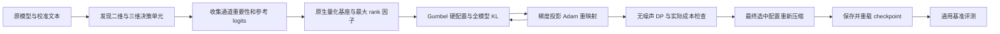

# RCO per-tensor：面向 MoE 部署的量化格式与低秩补偿联合分配

更新日期：2026-11-11。本文依据当前实现和实际 Qwen1.5-MoE 实验记录编写，用于描述目前可复现的方法。早期的跨框架设计稿包含部署设想，本文区分已实现、已测量和待验证的部分。

本次同步的轻量实验记录见 [GitHub 可查的结果快照](perf/rco_qwen15_20261111/README.md)。文中其余 `artifacts/runs/` 路径为本地运行产物，模型和逐题数据不随仓库上传。

## 1. 核心 idea

在给定压缩权重字节预算下，给模型中的每个可部署权重张量选择一个二元配置：**具体量化格式 q + 残差补偿秩 r**。例如 `IQ2_XXS_rank0`、`IQ3_S_rank16` 和 `IQ4_NL_rank32` 是不同候选。

这里的 per-tensor 与推理框架中实际承载权重的张量对齐：Attention 和共享专家逐个二维投影选择；路由专家按“层 × 投影类型”组成三维张量选择。同一三维张量中的所有专家共享格式与秩，但每个专家的权重独立量化、残差独立分解。

这个粒度减少同层专家使用不同位宽、不同 rank 带来的拆桶、拼接和 padding 需求，同时保留跨层、跨投影的混合配置自由度。低秩补偿为纯量化之外增加一种容量分配方式：某个张量可以选择更精确的量化格式，也可以选择较低精度格式并增加补偿秩。哪个组合更合适，由全模型校准集上的输出误差和实际字节成本共同决定。

**当前优化的可训练变量是配置 logits，原模型权重和补偿因子不作梯度训练。** 补偿因子由量化残差的随机低秩 SVD 产生。RCO 在本文中指代码里的预算流形优化：对配置梯度作切空间投影，用 Adam 更新，再重映射到期望预算面，并通过离散背包求解器产生可执行配置。

## 2. 决策单元与张量形状

设可压缩张量集合为 T，决策单元数为 N。每个单元 t 的候选集合为 K_t。

对于二维投影：

$$
W_t\in\mathbb R^{D_{out}\times D_{in}}.
$$


对于一层的 E 个路由专家：

$$
W_{l,gate}, W_{l,up}\in\mathbb R^{E\times I\times H},\qquad
W_{l,down}\in\mathbb R^{E\times H\times I}.
$$


例如 `L8_up_exps` 对应第 8 层全部专家的 up 投影，而不是整个 MoE 层，也不是某一个专家。即使 HF 模型当前把专家存为多个 Linear，这些 Linear 仍共享同一个决策行。

Qwen1.5-MoE-A2.7B 本次实例有 24 层，每层 60 个路由专家：

| 类型 | 单元数 | 一个单元包含的内容 |
|---|---:|---|
| Attention | 24 × 4 = 96 | q/k/v/o 中的一个二维投影 |
| 共享专家 | 24 × 3 = 72 | gate/up/down 中的一个二维投影 |
| 路由专家 | 24 × 3 = 72 | 同层 60 个专家的同类投影 |
| 总计 | 240 | 对应 4,488 个二维投影模块 |

Embedding、lm_head、router、LayerNorm、bias 等未纳入该搜索的参数保留原推理精度。本次保存和评测使用 FP16。`per-tensor` 不是对每个 GGML 小量化块单独选择格式；量化块仍按所选 codec 的固定格式编码。

实现入口：[tensor_units.py](../RCO_solver/tensor_units.py) 的 `discover_units`。

## 3. 候选表示：量化基座 + 独立的残差补偿

对于二维矩阵或三维张量中的专家切片 e，先得到量化后再解码的基座：

$$
\overline W_{t,e}^{q}=D_q(Q_q(W_{t,e})).
$$


对其残差做分解：

$$
R_{t,e}^{q}=W_{t,e}-\overline W_{t,e}^{q}
\approx U_{t,e}^{q,r}V_{t,e}^{q,r},
\qquad
\widetilde W_{t,e}^{q,r}=\overline W_{t,e}^{q}+U_{t,e}^{q,r}V_{t,e}^{q,r}.
$$


其中 U 的形状为 `[D_out,r]`，V 的形状为 `[r,D_in]`。前向写成：

$$
Y=X(\overline W^q)^T+(XV^T)U^T+b.
$$


r=0 时只保留量化基座。同层同类专家共享 r，但 U/V 数值各不相同；若部署时堆叠，形状分别是 `[E,D_out,r]` 和 `[E,r,D_in]`。它们用于补偿压缩残差，与另行训练任务适配器的过程不同。

本次搜索的格式集合为：

```text
Q2_K, Q3_K, Q4_K,
IQ2_XXS, IQ2_XS, IQ2_S,
IQ3_XXS, IQ3_S,
IQ4_XS, IQ4_NL,
F16
```

rank 集合为 `{0,16,32,64,128}`；F16 只保留 rank0，因此名义候选数为 `10×5+1=51`。不同单元还会屏蔽不满足形状对齐或校准统计要求的候选。

这里必须使用**具体张量格式**而不只是“2/3/4 bit”标签。例如 IQ2_XXS 与 Q2_K 的码本、块元数据、真实占用和量化误差都不同。搜索和压缩调用同一个固定版本的 GGML 原生编码器，版本为 `ceefd16daa2093730bf3340315fa2b84b286ddbc`。

### 3.1 输入通道重要性

在原模型上收集各投影输入通道的均方激活：

$$
s_{t,e,j}=\frac1{n_{t,e}}\sum_{x\text{ routed to }e}x_j^2.
$$


将这些统计量提供给需要 imatrix 的量化格式。若某专家未被校准数据命中，缺少必要统计量的格式会被屏蔽；三维决策组需要对整个专家组有效。代码不会为未命中的专家伪造均匀统计。

当前全模型 KL 模式没有另加显式的专家激活频率加权项：路由和实际 token 出现次数通过模型前向及最终输出误差影响目标。输入通道重要性、路由频率和残差 SVD 是三个不同概念。

### 3.2 搜索阶段共享最大 rank 的 SVD 前缀

对每个投影、每种格式 q，只求一次最大秩分解：

$$
R^q\approx U^q_{max}V^q_{max},\qquad
U^{q,r}=U^q_{max}[:, :r],\quad V^{q,r}=V^q_{max}[:r,:].
$$


实现使用 `torch.svd_lowrank`，将奇异值的平方根分别并入左右因子。这样不同 rank 可以共享基座和因子，避免为每个 `(q,r)` 都缓存一份完整解码权重。

这是随机低秩近似，不保证得到完整 SVD 的精确最优截断。最终压缩会对选中 rank 重新分解，因而最终 checkpoint 与搜索时的前缀候选可能有数值差异；质量评测必须以实际保存的 checkpoint 为准。

## 4. 预算：按实际编码字节计算

设格式 q 的块包含 G_q 个数，实际编码大小为 S_q 字节。满足形状对齐时：

$$
c_{t,(q,r)}=\sum_{e\in t}\left[
\operatorname{bytes}_q(D_{out,e},D_{in,e})+
2r_e(D_{out,e}+D_{in,e})\right],
\quad r_e=\min(r,D_{out,e},D_{in,e}).
$$


第二项对应本次使用的 FP16 U/V。codec 的 scale、码本索引等块内元数据已经计入第一项，不能统一用“参数量 × 名义 bit / 8”替代。形状不兼容时直接屏蔽候选，不静默 padding 或替换格式。

| 格式 | 元素/块 | 字节/块 | 实际基座 bpw |
|---|---:|---:|---:|
| IQ2_XS | 256 | 74 | 2.3125 |
| IQ3_S | 256 | 110 | 3.4375 |
| IQ4_XS | 256 | 136 | 4.25 |
| IQ4_NL | 32 | 18 | 4.5 |

当前预算的范围是**所选权重基座和补偿因子的有效载荷**。完整模型体积还包括未压缩参数、序列化开销、tokenizer 等；运行显存还包括激活、临时解码矩阵、工作区、KV cache 和分配器开销。

`--avg_bits 3.0` 将选中范围内的参数量 P 转成 `B=P×3/8` 字节预算，并不表示整个模型的所有参数均为 3-bit。

## 5. 全模型目标：保持原模型的输出分布

先对固定的校准集缓存原模型参考 logits。冻结模型权重，通过候选装配得到压缩模型，最小化逐 token 的正向 KL：

$$
\mathcal L=\frac1{|\mathcal D_{tokens}|}\sum_{x,i}
D_{KL}\left(p_{FP}(\cdot\mid x_{\le i})\;\|\;
p_{compressed}(\cdot\mid x_{\le i})\right).
$$


仅真实 token 参与均值；有 attention mask 时据此屏蔽 padding。本次每一步循环使用一个校准样本，参考分布和压缩分布来自相同输入。目标使用整个模型输出，能够反映各层误差的累积与交互，而不是简单相加各张量独立的权重误差。

仓库也提供 `tensor_proxy`：按输入通道重要性加权的残差平方误差进行较便宜的配置搜索。它适合对照或未来初始化实验，**此次 `55343` 使用的是 `e2e_kl`，没有把 proxy 结果作为已验证的 warm-start。**

## 6. RCO：连续配置概率、硬选择和预算约束

### 6.1 连续预算面

每个单元维护配置 logits `alpha[t,k]`，令：

$$
p_{t,k}=\operatorname{softmax}(\alpha_t)_k,\qquad
C(\alpha)=\sum_{t,k}p_{t,k}c_{t,k}=B.
$$


无效候选的 logits 被设为极小值。这里每个单元的成本向量不同：一个 Attention 投影与包含 60 个专家的三维投影不能使用相同的成本。

预算面的法向量为：

$$
n_{t,k}=p_{t,k}\left(c_{t,k}-\sum_jp_{t,j}c_{t,j}\right).
$$


将配置梯度 g 投影到预算面的切空间：

$$
g_T=g-\frac{\langle g,n\rangle}{\langle n,n\rangle}n.
$$


执行 Adam 更新后，沿成本方向重映射 `alpha <- alpha+s*c`。通过括区间和二分搜索求 s，使期望成本回到预算：

$$
\frac{d}{ds}C(\alpha+sc)=\sum_t\operatorname{Var}_{p_t(s)}(c_t)\ge0.
$$


每步还把 Adam 的一阶动量 `exp_avg` 投影到新的切空间。它是当前代码采用的约束优化流程，不构成对非凸 KL 目标的全局最优证明。

### 6.2 Gumbel + 可行的离散硬前向

在一步搜索中，采样 Gumbel 噪声并计算：

$$
p^{soft}=\operatorname{softmax}((\alpha+gumbel)/\tau).
$$


以带噪分数调用多选背包求解器，给每个单元选择一个候选，形成 `z_onehot`。构造直通估计：

$$
p^{STE}=\operatorname{stopgrad}(z-p^{soft})+p^{soft}.
$$


前向只执行被选中的格式与 rank；反向通过 soft 概率传播配置梯度。温度 tau 从 1.0 逐步降到 0.05。期望预算面约束的是未加噪 `softmax(alpha)`；硬配置是否满足实际预算由离散求解和实际成本复核保证，二者需要分别检查。

最后移除噪声，用 `log_softmax(alpha)` 再做一次多选背包求解，保存最终配置，而不是取最后一次带噪采样配置。

### 6.3 离散预算的数值处理

当前 DP 默认将相对成本离散到 resolution=2000 的预算网格。回溯之后，按实际浮点成本做超预算修复，并尝试用剩余预算进行收益为正的升级；输出时再次检查有效性和总预算。

因此它对网格化子问题进行 DP，再进行实际成本修复。**不能把它描述为对原始连续字节成本或真实任务损失的精确全局最优解。** 小预算单元的 rank 选择可能受到 DP 分辨率影响，后续应做分辨率消融。

实现入口：[manifold.py](../RCO_solver/manifold.py)、[e2e_ste.py](../RCO_solver/e2e_ste.py)。

## 7. 如何避免为所有候选做完整前向

令一个投影的输入为 X，上游梯度为 G。配置概率的梯度涉及每个候选输出与 G 的内积：

$$
g_{q,r}=\langle G,X(\overline W^q)^T\rangle+
\sum_{j=1}^{r}\sum_{token}
(XV_{j,:}^T)\,(GU_{:,j}).
$$


同一格式的不同 rank 共享第一项。第二项先逐 rank 维度算贡献，再做 `cumsum`，就能同时获得所有 rank 的前缀结果。

当 routed token 数少时，在激活空间完成这些内积；当 token 数多时，先构造 `G_W=G^T X`，在权重空间计算对应内积。这样避免为每个 rank 重新构建完整 `[D_out,D_in]` 候选矩阵。共享同一个决策行的专家模块将贡献累积到同一行配置 logits 上。

工程上还包括：原生 CPU 编码、转移 packed bytes 后用 Triton 解码、GPU 上按字节限制的 LRU，以及可选的原权重/U/V 常驻。LRU 保存的是 packed 基座或因子，解码的稠密权重通常是临时矩阵。首次候选初始化和 SVD 仍可能昂贵；不能用稳态 decode 加速比代替完整搜索耗时。

## 8. 从搜索到最终 checkpoint



关键产物：

| 文件 | 含义 |
|---|---|
| `best.json` | 决策单元到具体格式/rank 的映射 |
| `best_tensor_allocation.json` | 模块名、形状、类别、有效 rank、实际成本、搜索参数和历史 |
| `best.imatrix.npz` | 每个实际投影的通道重要性统计 |
| `compressed/qmodel.pt` | 序列化的压缩权重及相关状态 |
| `compressed/compensators.pt`、`ranks.json` | 补偿参数和 rank 信息 |
| `COMPRESSION_COMPLETE.json` | 原模型路径、配置和重要性统计的 SHA256 |

搜索、压缩和评测必须指向同一配置及重要性统计。重载后应检查序列化前后的参考 logits，再对实际 checkpoint 运行基准。

## 9. 当前实例与已经得到的证据

本次 checkpoint 位于 `artifacts/runs/rco_e2e/run_55343/compressed`，原模型为 Qwen1.5-MoE-A2.7B。搜索设置如下：

| 项目 | 本次值 |
|---|---|
| 模式 / 粒度 | e2e_kl / tensor |
| 决策单元 / 名义候选 | 240 / 51 |
| 校准样本 / 最大长度 / seed | 128 / 256 / 42 |
| 优化步数 / 学习率 | 300 / 0.1 |
| 所选参数范围 | 13,690,208,256 个权重元素 |
| 目标有效载荷预算 | 4,896 MiB，相当于所选范围平均 3.0 bpw |
| 最终有效载荷 | 4,871.3984375 MiB，约 2.98493 bpw |
| 全 checkpoint 目录 | 6,374,042,763 字节，5.9363 GiB |
| 原模型完整目录 | 约 26.6768 GiB |
| PIQA 0-shot validation | 1,458 / 1,838，acc 与 acc_norm 均为 79.3254% |
| PIQA PyTorch 峰值已分配显存 | 6.4322 GiB |

最终选中模式：路由专家 72 个单元全部 rank0；所有 down 投影为 IQ4_NL，gate/up 为 2-bit 系列。Attention 有 49/96 个单元使用补偿；共享专家有 31/72 个单元使用补偿。该结果支持“允许不同模块采取不同格式/rank”的设计，但不能单凭一次配置就断言这些投影在所有模型中都具有相同敏感度。

完整分配见[逐层配置表](perf/rco_qwen15_20261111/rco_e2e/run_55343/compression_config.md)；原始配置见[allocation manifest](perf/rco_qwen15_20261111/rco_e2e/run_55343/best_tensor_allocation.json)；已完成的 PIQA 结果见[results.json](perf/rco_qwen15_20261111/piqa/run_56019/results.json)。

截至本文建立时，WikiText-2、HellaSwag、LAMBADA-openai、MMLU 5-shot 正在新增评测，不能用进行中的部分成绩代替最终成绩。汇总会写入[评测结果表](perf/rco_qwen15_20261111/eval_suite_20261111/summary.md)。

新增评测使用混合分区的 Ampere GPU，PIQA 的历史记录使用 RTX 4090。初始严格逐元素参考检查因跨 GPU FP16 运算差异而停止，未进入计分；记录到的相对 L2 差异为 0.00127–0.00152，argmax 相同。当前入口首先验证实际使用格式的 GPU 解码与原生 CPU 解码逐值完全一致，再检查参考 logits：最大绝对差不超过 0.05、相对 L2 不超过 0.003、argmax 一致。每次运行保存实际误差和检查协议；这些阈值仅用于跨设备浮点一致性检查，不用于判定任务精度没有变化。

## 10. 部署边界与待验证假设

已验证的是本次 HF/PyTorch 压缩 checkpoint 的重载与推理，以及完整 PIQA。当前格式可以按三维张量统一选择，给 GGUF/FusedMoE 适配提供结构基础；但 PyTorch 按需解码后计算的结果不等于已经验证了部署引擎的 fused kernel、端到端速度或显存。

仓库 GGUF 导出器目前提供补偿 adapter 和基座量化 recipe，并不是完整的 HF-to-GGUF 基座转换流水线。外部重新量化若使用不同 imatrix、编码参数或权重，可能偏离保存的 checkpoint。本轮没有确认 llama.cpp IQ + 补偿的完整等价加载，也没有确认自定义 vLLM INT3 后端能够直接执行全部 IQ 类型。跨框架需要独立核对张量名、布局、量化 bytes、补偿缩放、logits 和任务成绩。

尚未验证：与原模型的同协议精度差距、相同完整体积下优于纯量化的幅度、rank 的预算收益、不同搜索粒度的质量/速度折中、跨 seed 稳定性，以及对其他模型的泛化。

## 11. 建议的下一轮对照与消融

1. **原模型基线**：相同 tokenizer、prompt、split、few-shot、WikiText 上下文和计分规则；报告压缩前后差值。
2. **固定全模型预算，允许/禁用补偿**：`r={0}` 对比 `r={0,16,32,64,128}`，并同时报告完整模型大小，避免只对齐部分 payload。
3. **粒度对照**：per-tensor 对比 per-expert-tensor；分别量化决策数、精度和真实部署碎片化，不能只比较代理损失。
4. **搜索目标对照**：tensor_proxy、e2e_kl、固定规则混合精度；统一候选、原生编码器和预算。
5. **rank 覆盖与 DP 分辨率**：尤其检查便宜的二维 Attention/shared 单元是否受到网格量化影响。
6. **SVD 前缀与最终 refit**：同一配置分别保存前缀因子和最终重分解因子，比较 KL、任务精度与体积。
7. **校准覆盖与稳定性**：改变样本量、长度、seed；记录未命中专家与被屏蔽候选比例。
8. **部署验证**：在实际 GGUF/vLLM 入口测量 TTFT、TPOT、吞吐、峰值显存和输出差异。

## 12. 代码入口与复现参数

- 单元、通道统计与真实成本：[tensor_units.py](../RCO_solver/tensor_units.py)。
- 全模型搜索编排：[full_model_search.py](../RCO_solver/full_model_search.py)。
- 硬前向、STE、共享 SVD 前缀和 KL：[e2e_ste.py](../RCO_solver/e2e_ste.py)。
- 预算几何与 DP：[manifold.py](../RCO_solver/manifold.py)。
- 压缩配置和最终保存：[BR_compress_auto.py](../examples/BR_compress_auto.py)。
- 原生 codec / GPU 解码：[brmoe_quant](../brmoe_quant)。
- 本轮任务协议与评分：[eval_compressed_suite.py](../bench/eval_compressed_suite.py)。

搜索命令的关键参数：

```bash
python -m RCO_solver.rco_search \
  --mode e2e_kl --granularity tensor \
  --model_path /path/to/qwen1.5-moe \
  --dataset_path /path/to/calibration.jsonl \
  --quant_types Q2_K,Q3_K,Q4_K,IQ2_XXS,IQ2_XS,IQ2_S,IQ3_XXS,IQ3_S,IQ4_XS,IQ4_NL,F16 \
  --ranks 0,16,32,64,128 --max_rank 128 \
  --avg_bits 3.0 --num_calib_samples 128 --seq_len 256 \
  --steps 300 --lr 0.1 --seed 42 \
  --output_file results/best.json
```

最终压缩需连同 manifest、imatrix 和固定 codec 一起保存；复现搜索还依赖环境、随机低秩分解和 GPU 数值路径，不能仅凭同一个随机种子承诺逐 bit 一致。
